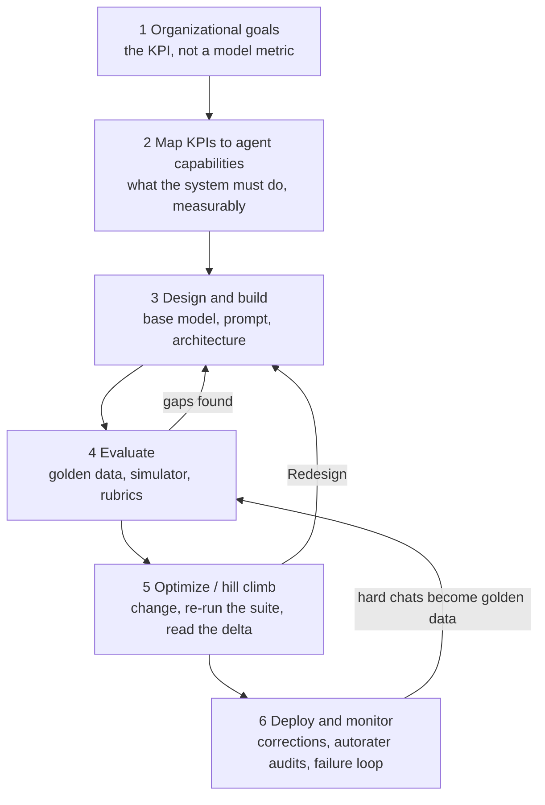

# The hill-climb lifecycle

This file covers what an eval is, the span, trace and session an agent leaves behind, and the six-stage development lifecycle for generative and agentic systems in Google's hill-climb framework: it builds the system backward from organizational KPIs, then improves it by hill climbing against measurements.

## What an eval is

An **eval** is a check of a generative system's output against defined criteria. Sampling makes the same prompt return different wording each run, so testing on exact text is unreliable ([claude-api-foundations.md](../claude-api-foundations.md)), and evals replace it. The criteria come from the feature's success criteria ([design-document.md](../design-document.md)) or, at organizational scale, from KPIs ([evaluation-plan.md](evaluation-plan.md)).

[genai-poc.md](../genai-poc.md) names three types by who or what judges the output: human, model-based and metrics-based.

## What an agent leaves behind: span, trace, session

| Term | What it is |
|---|---|
| Span | A single timed step, such as a model call or a tool call |
| Trace | A factual, immutable record of **one agent invocation**, a single turn. It captures the model inputs, the responses and the tool calls, in order. A trace is built from spans |
| Session | The **entire multi-turn conversation** between a user and the agent. It can contain several traces |

```
  session (the whole conversation)
  +----------------------------------------------------------+
  |  trace 1 (turn 1)        trace 2 (turn 2)     trace 3 ...|
  |  +-------------------+   +----------------+              |
  |  | span: model call  |   | span: model    |              |
  |  | span: tool call   |   | span: tool     |              |
  |  | span: model call  |   | span: model    |              |
  |  +-------------------+   +----------------+              |
  +----------------------------------------------------------+
```

## Why measure

Organizations invest in generative AI to achieve specific goals. A probabilistic model deployed without measurement can cause the organization to miss its key performance indicators (KPIs), which turns the investment into a failed one.

| Risk | What it looks like |
|---|---|
| Missed KPIs | The system doesn't perform as expected, so the goal it was bought for isn't met |
| Reputational damage | Embarrassing model outputs damage customer trust |
| Legal liability | Outputs accidentally violate compliance standards or laws |

### The ragged edge

As generative models improve, their capabilities **don't scale uniformly**. This is the **ragged edge:** getting better at one task doesn't guarantee a model gets better at other, closely related tasks. An improvement in one place has to be measured against the others instead of assumed.

## The six stages

This lifecycle differs from the AI engineering loop in what it starts from: it takes **organizational KPIs** into account and makes them the foundation for building the agent.



Three loops run through it. **Evaluate** sends the team back to Design and build when it finds gaps (such as missing guardrails). **Optimize** sends it back when hill climbing isn't enough and the system needs a redesign. **Deploy and monitor** feeds failures back into the golden data that Evaluate uses.

| # | Stage | What the team does |
|---|---|---|
| 1 | Organizational goals | Identify the organizational priority and turn it into a KPI. A KPI is an organizational goal, not a model metric |
| 2 | Map KPIs to agent capabilities | Map the KPI to technical characteristics of the system that can be measured and hill climbed |
| 3 | Design and build | Pick a base model, draft a prompt, "vibe" check the output, and redesign the architecture when the checks show it isn't enough |
| 4 | Evaluate | Build golden data, a data simulator and rubrics validated by humans and scaled with autoraters, then write a formal pre-launch evaluation plan |
| 5 | Optimize / hill climb | Run a baseline, change the system, re-run the evaluation suite and climb until the thresholds and the KPI are met |
| 6 | Deploy and monitor | Run the post-launch evaluation plan on the live system and feed failures back into the golden data |

## Worked example: a returns and refunds chatbot

### 1. Organizational goals

The organizational priority is to process refunds faster, with a KPI for the support team of high customer satisfaction survey scores. This leads to a KPI for the e-commerce team:

> **Auto-resolve 30% of return requests within 2 hours while keeping customer satisfaction above 4.5/5.**

### 2. Map KPIs to agent capabilities

To auto-resolve refunds and returns safely and keep satisfaction up, the system must achieve:

- **High classification accuracy** for return requests.
- **Low errors** when calculating refund amounts.
- **Quick escalation to a human support agent** for questions the chatbot can't answer.
- **Pleasant chatbot interactions** for users.

### 3. Design and build

1. The team chooses a base model, drafts an initial prompt and does **vibe checks** on chatbot quality. The outputs show major issues deciding whether a product is eligible for return and how much to refund.
2. The team pivots to an **agentic architecture** that separates the refund and return flows into multiple subagents. Vibe testing suggests the system is improving, but given the cost of errors and the risk to customer satisfaction, a **fully automated chatbot is too risky** for the initial launch.
3. More experiments and vibe testing convince the team they can reliably identify when a customer makes a refund or return request.
4. The team **redesigns** the system from fully automated into a **partially human-in-the-loop system**: the chatbot gathers the information for the request, and a **human support rep confirms or intervenes** before a refund is issued or a return accepted.

This is the redesign [genai-poc.md](../genai-poc.md) points to when it lists tasks that demand perfect accuracy without human oversight as a poor fit, and the mandatory human checkpoint that [stakeholder-discovery.md](../stakeholder-discovery.md) derives from "clinicians will review the output anyway". Here the decision comes from vibe testing and the cost of errors, and stage 6 then tracks how often reps correct the bot.

### 4. Evaluate

- The team gathers **golden** historical data of refunds and returns from the human support agents, to identify edge cases and scenarios to test. The data feeds a **data simulator**, which the team keeps monitoring against manual and automated checks for correctness.
- The team builds a **rubric** on chatbot helpfulness and validates it with human annotators before scaling its use with **autoraters**. See [rubrics-and-llm-judge.md](rubrics-and-llm-judge.md).
- The evaluation turns up **impolite customer behavior and strange requests** that make the chatbot go off the rails. The team goes back to **Design and build** to add guardrails for these cases.
- The team writes a **formal pre-launch evaluation plan** to check that the organizational KPIs will be met:

| Evaluation | What it is | Launch gate |
|---|---|---|
| Simulation | How simulated evaluation data is generated, how its relevancy is ensured, and how humans partly review it for quality | |
| Helpfulness autorater | A helpfulness rubric used by autoraters and validated by humans | Helpfulness rubric score thresholds must be met |
| Refund and return correctness | An annotation workflow (mainly LLM-based, some human oversight) over random simulated chats, checking return and refund determinations and calculations | Thresholds for return determination precision and recall and for refund calculation mean absolute error must be met |
| Chatbot-to-human handoff | An annotation workflow (mainly LLM-based, some human oversight) over random simulated chats, measuring precision and recall of handoffs | Handoff precision and recall thresholds must be met |
| Guardrails, regressions and edge cases | A manually created test set for specific guardrails, other edge cases and regressions the team has noticed | 100% pass rate required |
| Customer satisfaction | A plan to A/B test a cohort of customers, looking for drift in satisfaction surveys | |

### 5. Optimize and hill climb

1. **Baseline.** The first full test on simulated data shows that refund and return functionality is adequate, guardrails are respected and the chatbot is helpful enough. But it **fails the required thresholds for return request classification accuracy and handoff precision**: it often fails to escalate complex requests, or escalates too slowly.
2. **Change and re-run.** The team adjusts the routing agent's instructions and refines the escalation triggers in the prompt, then re-runs the evaluation suite. The scores show a significant **positive delta**.
3. **A/B test.** Customer satisfaction surveys come out lower than expected. The team analyzes the chat logs and returns to the **helpfulness rubric**, with more rounds of rubric development and **human agreement testing**, and tests that the **autorater** applies the rubric consistently.
4. **Climb and launch.** This lets the team hill climb the system instructions. A later A/B test puts satisfaction close to the target KPI, and they launch.

#### Diagnose before re-prompting

When a first-pass response misses the mark, the instinct is to add more words to the prompt and try again. That instinct almost always makes the problem harder to diagnose and rarely fixes it.

Stage 5 is the measured alternative. The baseline names what fails (return classification accuracy and handoff precision, not "the chatbot is bad"), and the team changes the part that failed (the routing agent's instructions and the escalation triggers), then re-runs the evaluation suite and reads the delta.

```
  re-prompt by instinct          hill climb
  ---------------------          ----------
  response misses the mark       baseline test fails named thresholds
        |                              |
        v                              v
  add more words, retry          change the part that failed
        |                              |
        v                              v
  unclear what helped            re-run the suite, read the delta
```

### 6. Deploy and monitor

The team runs a **post-launch evaluation plan** on the live system:

| Monitor | What it tracks | Why |
|---|---|---|
| Agent correction rates | How often support reps edit the bot's gathered return details or override its refund determinations before confirming | A spike in corrections signals the prompts need re-evaluating |
| Helpfulness monitoring | The helpfulness autorater runs daily on sampled production chats, backed by weekly human audits of a random cohort | Keeps the autorater calibrated to human judgment |
| Failure loop feed | Chats with low satisfaction scores or unexpected human escalations are reviewed, and the difficult queries are added to the offline golden test dataset | Offline evaluations evolve alongside real customer behavior |

## Related

- [evaluation-plan.md](evaluation-plan.md): builds on this lifecycle. It adds the KPI-to-system-goal-to-metric translation behind stages 1 and 2, a draft plan with thresholds, a nine-step roadmap for building the evaluation that stages 4 to 6 use, and how to simulate the test data of stages 4 and 5.
- [rubrics-and-llm-judge.md](rubrics-and-llm-judge.md): how to write the helpfulness and tone rubrics that stage 4 validates with humans and stage 5 refines, and the LLM judge those rubrics are scaled up with.
- [stakeholder-discovery.md](../stakeholder-discovery.md): the same translation from business words to constraints that stage 1 and 2 do, here ending in measurable metrics and there in design requirements.
- [design-document.md](../design-document.md): the design document fixes success criteria before the build, and its calibrated LLM judge is the same mechanism as the autorater used here.
- [genai-poc.md](../genai-poc.md): the PoC is a time-boxed validation before launch, with success metrics and three evaluation types. This lifecycle derives its metrics from KPIs and continues past launch with monitoring and a failure loop.
- [bedrock.md](../../../aws/aws-services/aws-ai/bedrock.md): Bedrock Guardrails are safeguards on model inputs and outputs, and the manual guardrail test set with a 100% pass rate is the launch check for safeguards of this kind. Bedrock's Model Evaluation covers the three evaluation types the stages draw on.
- [agent-orchestration.md](../agent-orchestration.md): the stage 3 pivot to subagents and a human-in-the-loop step is the workflows-versus-agents decision applied to the refund and return flows.
