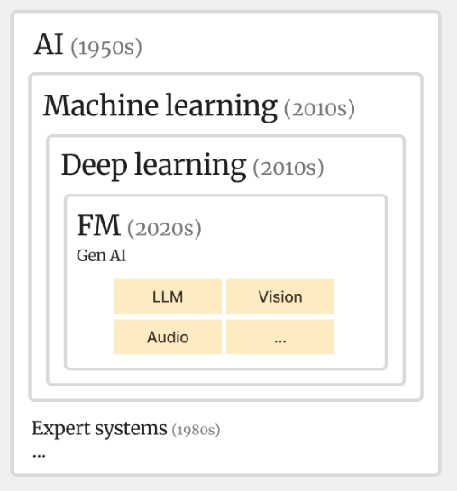

# Core concepts

- Graphic representation of the relationship between some of these concepts
	

## Generative AI

Generative AI produces original content including text, images, audio, video, and code based on patterns learned from training data. Foundation models serve as the underlying technology, providing general intelligence that you can adapt for specific use cases through techniques like fine-tuning, prompt engineering, and retrieval-augmented generation.

## The role: AI engineer/generative AI engineer

- Sources
	- [AWS Generative AI Developer Advanced Learning Plan (includes Labs)](https://skillbuilder.aws/learning-plan/BGTH16YCTU/aws-generative-ai-developer-advanced-learning-plan-includes-labs/ZDN46CX881)

| Responsibility | What it involves |
|---|---|
| Solution architecture and design | Designing solutions that integrate foundation models with existing systems and data sources: evaluating architectural patterns, selecting models, and planning deployment strategies that meet business requirements and technical constraints |
| Integration and implementation | Implementing solutions with services like Amazon Bedrock, Amazon SageMaker AI, and supporting infrastructure: configuring APIs, setting up data pipelines, and implementing secure, scalable deployments |
| Performance optimization | Monitoring and optimizing applications for performance, cost, and accuracy: tuning model parameters, implementing caching strategies, and optimizing resource utilization across the stack |
| Security and compliance | Verifying that solutions meet security requirements and regulatory compliance standards: access controls, data encryption, and audit logging while maintaining data privacy and governance |

## Foundation models
 
 Foundation models are **large deep learning neural networks** trained on massive datasets that have changed how you approach machine learning. Rather than develop AI from scratch, you use foundation models as starting points to develop ML models that power new applications more quickly and cost-effectively.

A unique feature of foundation models is their **adaptability**. These models can perform a wide range of disparate tasks with high accuracy based on input prompts, including 

- natural language processing
- question answering
- image classification
- code generation
- visual comprehension
- and speech-to-text conversion

Foundation model can then be tuned and adjusted to solve specific needs

### Model types

Foundation models fall into two primary categories based on their design and intended use

-  **general-purpose models** 
	- trained on diverse, broad datasets spanning multiple domains and languages, making them versatile for various applications.
-  **specialized models** 
	- Trained on domain-specific datasets focused on particular industries, tasks, or use cases. Their training data is curated from specialized sources like medical journals, legal documents, or scientific papers. They excel in their target domain by incorporating specialized knowledge and terminology that general models may lack. Examples include BioGPT for biomedical text generation, AlphaFold for protein structure prediction, LEGAL-BERT for legal document analysis, and CodeT5 for software development tasks.

### Integration and deployment approaches 

There are different ways to integrate a foundation model in a system, depending on the needs:

> *In the following list even though AWS service-related services or approaches are mentioned, these may apply to other hyper-scaler vendors such as Google or Microsoft*

- **Amazon Bedrock integration (unified API):**
	- [bedrock](../aws/aws-services/aws-ai/bedrock.md) provides a unified API to access multiple foundation models without managing infrastructure.
	- This might be the easiest way to integrate a foundation model using AWS 
- **[AWS AI Factories](../aws/aws-services/aws-ai/ai-factories.md) integration (on-premises):**
	- "On-premises" describes where the hardware sits, not who owns and runs it. AWS ships, installs and operates its own AI infrastructure inside the customer's data center.
	- Suitable for cases when the company data has 
		- residency requirements
		- regulated industries with strict compliance needs
		- scenarios requiring low-latency inference close to data sources
		- and enterprises wanting cloud-like AI capabilities within their own security perimeter.
	- Split of responsibilities:
		- **The customer provides** the building, floor space, power, cooling, physical security and the network uplink. Their data, models and apps stay inside their own security perimeter.
		- **AWS provides and operates** the hardware (GPUs, Trainium chips, servers, storage, networking). It patches, monitors and replaces failed parts, and runs AI services such as Bedrock and SageMaker AI on top.
	- The site stays connected to an AWS Region, but that link mostly carries management traffic (health checks, software updates, telemetry, billing). Inference and training run locally, next to the data.
	- How the pieces connect:
		```
		  CUSTOMER DATA CENTER                      AWS REGION
		 +-----------------------------------+     +-------------------+
		 |  AWS-owned AI racks               |     |                   |
		 |  +-----------------------------+  |     |  control plane:   |
		 |  | Bedrock / SageMaker AI      |  |<--->|  monitoring,      |
		 |  | GPUs / Trainium, storage    |  | mgmt|  updates, health, |
		 |  +-----------------------------+  | link|  billing          |
		 |        ^                          |     |                   |
		 |        | local, low-latency       |     +-------------------+
		 |  customer apps + data             |
		 |  (data stays here)                |
		 +-----------------------------------+
		```
	- This is the reverse of a typical hybrid setup. There, on-premises servers send data or workloads up to the cloud. Here, the cloud's hardware comes down to the customer.
	- That's why it fits data residency, regulated industries and low-latency inference: the data never leaves the building, and the customer still doesn't build or run their own GPU cluster.
- **[Amazon SageMaker AI](../aws/aws-services/aws-ai/sagemaker.md) integration (self-host):**
	- This might be suitable for cases where we need to fine-tune foundation models 
	- This offers a lower level of abstraction when it comes to managing the integration, and the deployment of a FM
- **Direct provider API integration (direct API):**
	- Consuming the API from model providers directly, such as Claude, OpenAI, or Gemini, offers the main benefit of potentially early access to new features
	- Depending on how these are consumed, the team may also fall into a bottleneck situation. Say, for example, if they only use Gemini with the specific Gemini API, this is where tools like the Vercel AI SDK come in very handy 

### Model customization approaches 

- **Fine-tuning** adjusts model parameters using your specific training data to improve performance for domain-specific tasks. Requires training and validation datasets. On Amazon Bedrock, a fine-tuned model typically needs Provisioned Throughput for deployment.
- **Prompt / Context engineering** optimizes input prompts to achieve better outputs without modifying the model itself. This cost-effective approach uses iterative refinement of prompts, examples, and instructions. The techniques are in [prompt-and-context-engineering.md](ai-engineering/prompt-and-context-engineering.md), which also covers managing what goes into the context on each turn.
- **Continued Pre-Training (CPT)** extends foundation models by training on domain-specific data before fine-tuning, helping models grasp specialized terminology and concepts. 
	- Requires either the model's weights (open-weight models such as Llama, Mistral or Qwen, trained on SageMaker or your own GPUs) or a provider that runs it for you (Nova on SageMaker or Bedrock). Closed models such as Claude can't be continually pre-trained; customize them with prompt/context engineering or RAG instead.
	- Trains on **unlabeled** domain text (manuals, tickets, code) with the same objective as the original pre-training: predict the next token. Fine-tuning is the step that needs labeled pairs.
	- Process: 
		- collect text → 
		- clean and dedupe → 
		- mix in some general text → 
		- train at a small learning rate → 
		- evaluate on domain and general tasks → 
		- fine-tune to restore instruction following → 
		- deploy.
	- Main risk is **catastrophic forgetting**: the model loses general skills. Mixing in general text and evaluating on general tasks guard against it.
- **[Nova Forge](../aws/aws-services/aws-ai/nova-forge.md) (aws specific)** enables building custom frontier models with Amazon's Nova technology, providing infrastructure and tools **to create large language models from scratch**. Supporting models up to 1 trillion parameters with flexible deployment, it serves organizations needing highly specialized AI capabilities beyond adapting existing models.

#### CPT vs Nova Forge

CPT is a technique, and Nova Forge is an AWS service. The difference is where each one enters the model's training:

```
  AMAZON'S TRAINING OF A NOVA MODEL
  [pre-training] -> [mid-training] -> [post-training] -> finished model
       ^                 ^                  ^                 |
       |                 |                  |                 v
       +---- Nova Forge: start from any checkpoint     CPT: start here,
             and mix your data with Amazon's data      add your domain
                                                       text on top
```

| | Continued Pre-Training (CPT) | Nova Forge |
|---|---|---|
| What it is | A vendor-neutral technique | An AWS service built on Nova |
| Needs the model's weights | Yes: open-weight models, or a provider running it for you | No: AWS holds the Nova checkpoints |
| Starting point | A finished model | Early, middle or late Nova checkpoints |
| Training data | Only your unlabeled domain text | Your data mixed with Amazon's curated data |
| Main risk | Catastrophic forgetting | Cost and effort |
| Cost and effort | Moderate | High, aimed at large organizations |

Mixing your data in at an earlier stage is why Nova Forge forgets less: the domain becomes part of the model's foundation instead of a layer on top.

## Retrieval-augmented generation (RAG)

**Problem:** Foundation models have knowledge cutoffs and lack access to your specific or proprietary information, leading to outdated responses or hallucinations.

***Solution:*** RAG connects foundation models with external knowledge sources, retrieving relevant information to ground responses in factual sources. It usually relies on a vector database for semantic search, often alongside a keyword index for BM25 (see [The RAG pipeline](#the-rag-pipeline)), and it is used to enrich the context of an LLM.

**Components:** RAG systems rely on five essential components that work together to transform raw information into contextually relevant responses.

1. Document processing: Chunks knowledge while maintaining context (see [Chunking](#chunking))
2. Embedding models: Converts text to mathematical vectors (see [Semantic search](#2-semantic-search-embeddings))
3. Vector storage: Efficiently stores and searches vectors
4. Query processing: Matches user questions to relevant content (see [Searching](#searching) and [Reranking](#reranking))
5. Response generation: Combines retrieved context with queries

### Two forms: classical RAG and agentic search

Instead of loading every document into the context, the system keeps the material outside the context window, finds the parts most relevant to the current request, and gives the model only those parts. The model answers from that retrieved slice rather than from the whole library. Both forms do this. The difference is **timing**: when the relevant slice is found.

| | Classical RAG | Agentic search |
|---|---|---|
| Upfront work | Heavy: split the sources into chunks, convert each to an embedding (numbers that capture its meaning) and store them in a database, all before anyone asks | None: no index, no pre-built database |
| When the slice is found | At query time, by matching against the index built in advance | At the moment of need: the model works out what it needs, then fetches it |
| How it finds it | The question is converted to the same kind of numbers, and the chunks with the most similar numbers are returned | The model searches live sources, reads documents on demand and pulls in results as the task unfolds |

```
  CLASSICAL RAG                       AGENTIC SEARCH

  before any question:                before any question:
    chunk -> embed -> store             (nothing)

  at question time:                   at question time:
    embed question                      model decides what it needs
      -> nearest chunks                   -> searches / reads / fetches
      -> LLM answers                      -> repeats as the task unfolds
```

The sections below (the pipeline, chunking, searching and reranking) detail classical RAG.

#### Progressive disclosure in agentic search

Agentic search only stays efficient if the agent can see a high-level overview of what exists before it opens anything. With no tool that gives that overview, the agent may end up loading all the content and fill its context window quickly. Give it tools that disclose content in layers instead:

| Pattern | How it works | Example |
|---|---|---|
| Hierarchical retrieval | Index or table of contents, then section summaries, then full details | `list_categories()` -> `get_category_summary()` -> `get_item_details()` |
| Metadata-first | Return titles, dates and tags before content, so the agent filters before it retrieves full documents | A listing call that returns titles and tags only |
| Chunked access | Get the first N results, then paginate only if they're not enough | `search(query, limit=5)` -> `get_more_results(offset=5)` if insufficient |

### The RAG pipeline

```
 INGESTION (ahead of time; results are cached)

   documents --> chunking --+--> embedding model --> vector store
                            |
                            +--> keyword index (for BM25)

 QUERY (on every user request)

   user query
       |
       v
   query rewriter-------------------------|
       |                                  |
       | semantic query                   | keywords
       v                                  v
   embedding search                   BM25 search
       |                                  |
       +--------------+-------------------+
                      v
          reciprocal rank fusion
                      |
                      v
          reranking (e.g. 30 chunks -> a few)
                      |
                      v
          LLM answers using the chunks
```

### Chunking

- Chunking is a strategy to split large content that might be useful for an LLM. We chunk the large document to make it easier to search, and to avoid injecting a lot of content into the context window.
- The chunking strategy you choose depends on the content you are about to chunk. If you know that the content has a specific structure, you can be confident with the structural chunking approach.
- LangChain provides a package for doing different types of chunking: [LangChain text splitters](https://docs.langchain.com/oss/javascript/integrations/splitters)

| Strategy   | Splits by                                                                | When to use                                | LangChain splitter                                                                                            |
| ---------- | ------------------------------------------------------------------------ | ------------------------------------------ | ------------------------------------------------------------------------------------------------------------- |
| Fixed-size | A set number of characters. The most basic strategy                      | Content with no reliable structure         | [Length-based](https://docs.langchain.com/oss/javascript/integrations/splitters#length-based)                 |
| Structural | The document's own structure, such as headings, paragraphs and sentences | Content with a known, consistent structure | [Text-structure-based](https://docs.langchain.com/oss/javascript/integrations/splitters#text-structure-based) |

- Sources
	- [Chunking intro (AI Hero)](https://www.aihero.dev/workshops/retrieval-skill-building-day-2-u45nl/chunking-intro-2lxwn)
	- [Fixed-size chunks (AI Hero)](https://www.aihero.dev/workshops/retrieval-skill-building-day-2-u45nl/fixed-size-chunks-dsxci)
	- [Structural chunking (AI Hero)](https://www.aihero.dev/workshops/retrieval-skill-building-day-2-u45nl/structural-chunking-h4xti)
	- [Structural chunking in action: chunks.ts](https://github.com/estebanfelipep/ai-hero-cohort-002-skill-building/blob/main/exercises/03-retrieval-day-2-skill-building/03.03-structural-chunking/problem/api/chunks.ts)

### Searching

These are different approaches for retrieving relevant information based on the user query.

#### Query rewriting

- Usually, whenever you are retrieving information, you want the original user query to be parsed (processed) by a **query rewriter**: an agent whose job is to produce:
	- the specific query the semantic search runs with (embeddings)
	- a list of keywords the keyword search runs with (BM25)

```
 user query:     "hey, why does my laptop keep shutting down
                  since I installed last week's update?"
                          |
                    query rewriter
                 +--------+--------+
                 v                 v
 semantic query:                keywords:
 "laptop shuts down after       ["laptop", "shutdown",
  installing a system update"    "update"]
```

#### 1. BM25 algorithm (keyword-based matching)

- A keyword search algorithm.
- It is a ranking function used by search engines to estimate the relevance of documents to a given search query.
- Really useful when you want to do keyword matching, when you say "I want to find this keyword in this document".
- Sources
	- [Okapi BM25 (Wikipedia)](https://en.wikipedia.org/wiki/Okapi_BM25)
	- [Overview of the BM25 algorithm (AI Hero)](https://www.aihero.dev/workshops/retrieval-skill-building-kmlhc/overview-of-the-bm-25-algorithm~qrr4a)
	- [Retrieval with BM25 exercise](https://github.com/estebanfelipep/poland-vercel-ai-sdk-workshop/tree/main/exercises/08-retrieval/08.1-retrieval-with-bm25/problem)

#### 2. Semantic search (embeddings)

- Better for broader semantic and meaningful connections between a document and a query.
- Embeddings are usually used to search the semantic similarity between a query and an array of embeddings.
- For example, to answer a user query based on a given set of private documents (imagine your company's private documents):

```
 1. embed the user query            ---> query embedding
 2. embed the documents' chunks     ---> chunk embeddings
    (cached ahead of time, not          |
     regenerated on each request)       |
 3. compare the query embedding to every chunk embedding
                    |
                    v
 4. sort the chunks by their similarity scores
                    |
                    v
    at this point you only have the list of the
    most relevant chunks for the user query
                    |
                    v
 5. give those chunks (the sources) to the LLM,
    so it can answer the user query
```

#### 3. Reciprocal rank fusion (RRF)

- Taking the results of keyword search (BM25) and semantic search (embeddings) and fusing those ranking systems together is the most productive way of getting the best results.

| | Keyword search (BM25) | Semantic search (embeddings) |
|---|---|---|
| Matches | Exact keywords | Meaning |
| Strong when | You want to find this keyword in this document | The query and document are related in meaning, not wording |

- **How it scores:** each chunk's score is the sum, over every ranking it appears in, of `1 / (k + rank)`. `k` is a constant that softens the gap between top ranks; Elastic's default is 60. A chunk ranked well by both methods beats one ranked first by only one.

| Chunk | BM25 rank | Embedding rank | RRF score (k = 60) | Fused rank |
|---|---|---|---|---|
| B | 2 | 1 | 1/62 + 1/61 = 0.0325 | 1 |
| A | 1 | 3 | 1/61 + 1/63 = 0.0323 | 2 |
| C | not found | 2 | 1/62 = 0.0161 | 3 |

- Sources
	- [Rank fusion explainer](https://github.com/estebanfelipep/poland-vercel-ai-sdk-workshop/tree/main/exercises/08-retrieval/08.3-rank-fusion/explainer)
	- [Rank fusion (AI Hero)](https://www.aihero.dev/workshops/retrieval-skill-building-kmlhc/rank-fusion-r3fg2)
	- [Reciprocal rank fusion (Elasticsearch docs)](https://www.elastic.co/docs/reference/elasticsearch/rest-apis/reciprocal-rank-fusion)

### Reranking

- Reranking is about passing a larger set of search results (like 30 chunks) to a reranking model, which evaluates them against your query and returns only the truly relevant ones.
- The reranking process works in stages:

```
 1. retrieve a larger set of results   [30 chunks]
                    |
                    v
 2. an LLM evaluates which ones are truly
    relevant to the user's searchQuery
                    |
                    v
 3. only the most relevant chunks are  [a few chunks]
    returned
```

- Sources
	- [Reranking (AI Hero)](https://www.aihero.dev/workshops/retrieval-skill-building-day-2-u45nl/reranking-tgdxs)
	- [Ranking and reranking (Elastic docs)](https://www.elastic.co/docs/solutions/search/ranking)

### Clarification loop

- [Clarification loop (YouTube)](https://youtu.be/xc63tFIIfeA?si=4tuG4M-HB6KnE_QO&t=227)
