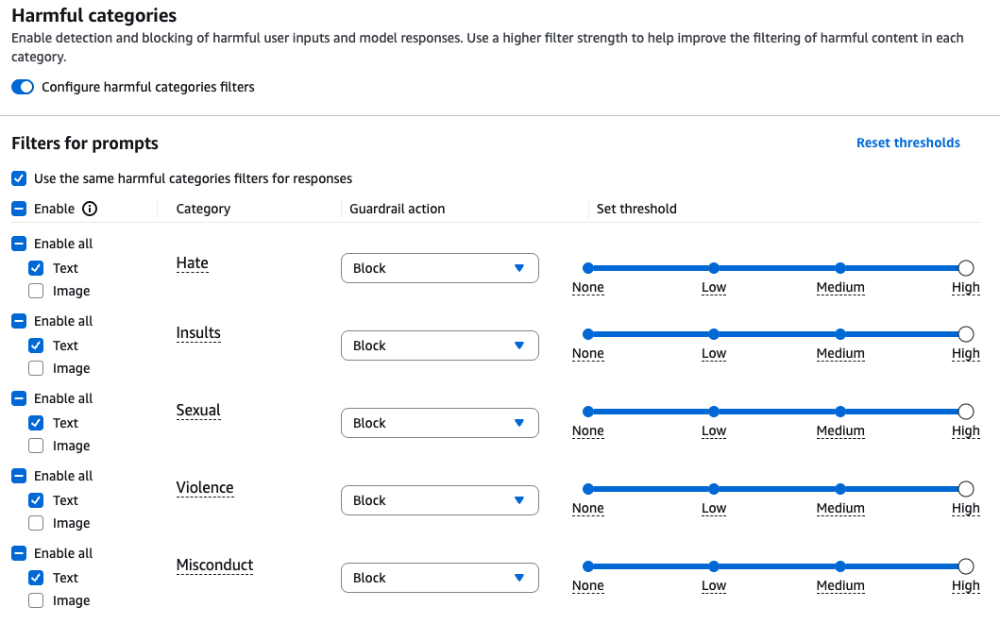

In a simplified way, what Amazon Bedrock does is to offer a set of features (it offers an abstraction). We should be able to get the same features with more granular control if we went with just the AI SDK, for example.

Even though Amazon Bedrock and related tools offer a nice UI to set up some of these features, one of the trade-offs is versioning. When you create a knowledge base (for RAG), it's not easy to set up versioning, or if you set up an MCP target with Amazon Bedrock Agent Core, you set up the tool description in there. You're basically creating an MCP tool that's outside of your control when building an agent with code.

## Features

- Managed FM: accessible to developers through a single API
	- Amazon Bedrock is a fully managed service that provides access to high-performing foundation models (FMs) from leading AI companies and Amazon through a unified API.
		- AWS
	- Anthropic
	- Meta
	- Google (Gemini)
	- Amazon Nova Pro is a multi-modal Amazon model, able to analyze data and images together, such as sensor data and equipment images.
	- and more ...
	- The models fall into families by task:

		| Family | What it does | Examples on Bedrock |
		|---|---|---|
		| Text generation | Generates text; models differ in capabilities, performance and cost | Claude (Anthropic), Amazon Titan |
		| Multimodal | Processes text, images and documents together | Amazon Nova, Claude (vision) |
		| Embedding | Converts text into vectors that capture meaning, for semantic search, document comparison and recommendations | Amazon Titan Embeddings |
		| Code generation | Programming assistance: developer tools, code reviews, documentation from code | Several models |

	- Amazon Nova 2 comes in tiers that match performance and cost to the requirement:

		| Tier | For |
		|---|---|
		| Nova 2 Pro | Complex tasks |
		| Nova 2 Lite | Cost-effective use cases |
		| Nova 2 Sonic | Real-time conversations |
		| Nova 2 Omni | Multimodal capabilities |
- Integration options, from simplest to most complex:
	- **Inference API:** the Bedrock Runtime gives direct access to models through REST calls: send a prompt, get a response, with minimal setup. Ideal for PoCs and rapid prototyping.
	- **Knowledge Bases:** RAG without managing vector databases or embedding pipelines (see RAG below).
	- **Agents:** orchestrate multi-step workflows that combine models with external tools and APIs.
	- **Model Evaluation:** compares models systematically on your own datasets and criteria (see below).
- Evaluations with different FM (Model Evaluation, also called Bedrock Evaluations)
	- Compares models on your own data and evaluation criteria, which streamlines model selection in a PoC and keeps measuring quality after it.
	- Evaluation types:
		- **Human evaluation:** human evaluators give direct feedback on outputs.
		- **Model-based evaluation:** an AI model evaluates another model's outputs.
		- **Metrics-based evaluation:** quantitative metrics calculated automatically.
- It is serverless
	- Amazon Bedrock is fully managed and serverless, so there is no model to deploy and no endpoint to manage. You call the model on demand through the Bedrock Runtime API.
- Supports fine-tuning natively: you give Bedrock labeled training and validation data, and it produces a custom version of a supported model. A fine-tuned model typically needs Provisioned Throughput to run. For lower-level control over training, use [sagemaker](sagemaker.md) instead.
- RAG
	- Vector databases through Amazon OpenSearch Serverless
    - Amazon has a frontier model (“Amazon Titan Embeddings”) to embed data
	- We can create a knowledge base on Bedrock. The flow is:
	    1. Data source (S3 bucket) →
	    2. Bedrock chunks the documents →
	    3. Embedding model (Titan Embeddings) converts chunks to vectors →
	    4. OpenSearch Serverless stores the vectors
	    
	    Bedrock orchestrates this: it reads from S3, calls the embedding model, and writes to OpenSearch. The OpenSearch Collection is purely storage for the vectors—it doesn't do the embedding transformation itself.
	    
	    Think of it as: Bedrock KB uses OpenSearch as vector storage, not as the embedding engine.
- Prompt management
	- Prompt management saves, versions, and manages prompts in Amazon Bedrock. Reusable prompts with variables are created and tested with different foundation models, such as Amazon Nova 2 Lite, and then saved as versions that applications call by ID for production use.
- Guardrails
	- Guardrails implement safeguards customized to your application requirements and responsible AI policies.
	- You can set up guardrails for inputs and outputs of models.
- Encryption
	- **In transit:** automatic. TLS 1.2+ over HTTPS endpoints, and every API request is SigV4-signed. Traffic between AWS services is protected, and AWS PrivateLink adds optional private connectivity from a VPC.
	- **At rest:** automatic, with AWS-owned keys by default; customer managed [KMS](../aws-security/kms.md) keys when more control is needed.
	- UI in amazon
		- See how you can set up guardrails based on categories. This is a high-level abstraction of setting up guardrails through aws.
		

## Related

- [ai-orchestration-on-aws.md](../../aws-ai-engineering/ai-orchestration-on-aws.md): Bedrock is the central AI engine of the predictive maintenance example there: it retrieves context from an OpenSearch RAG knowledge base and answers technicians' natural-language questions.
- [bedrock-poc.md](../../aws-ai-engineering/bedrock-poc.md): how to build a PoC on Bedrock, starting from the Inference API and comparing models with Model Evaluation, with a healthcare extraction example.
- [genai-poc.md](../../../ai/ai-engineering/genai-poc.md): Model Evaluation implements the PoC's comparative evaluation stage and the three evaluation types described there.
- [prompt-engineering.md](../../../ai/ai-engineering/prompt-engineering.md): prompt management versions the prompts built with those techniques.
- [kms.md](../aws-security/kms.md): a customer managed KMS key replaces Bedrock's default AWS-owned key for encryption at rest.
