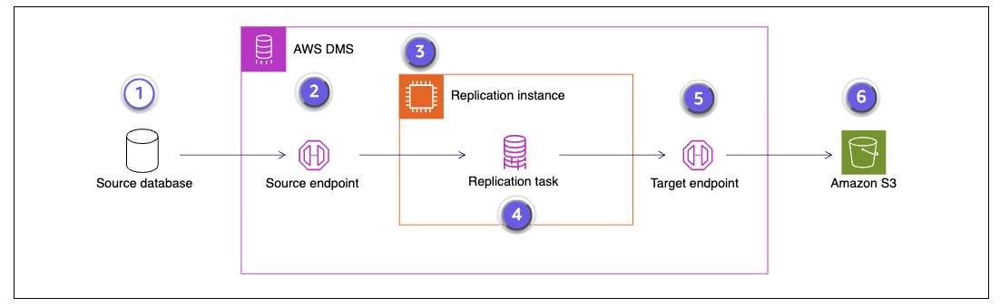

# AWS Database Migration Service (DMS)

AWS DMS: ingesting relational and non-relational databases into the data lake, by full load or change data capture.

## Sources

- [Using Amazon S3 as a target for AWS Database Migration Service](https://docs.aws.amazon.com/dms/latest/userguide/CHAP_Target.S3.html): AWS DMS User Guide, the S3 target settings.
- [Create an AWS Glue Data Catalog with AWS DMS](https://aws.amazon.com/blogs/database/create-an-aws-glue-data-catalog-with-aws-dms/): AWS Database Blog, DMS populating the Glue Data Catalog automatically.

## What it is

AWS DMS (Database Migration Service) ingests data from relational and non-relational databases and loads it into the data lake. It's the ingestion service for the "databases" data source (CRM, ERP, CMS applications).

DMS migrates database to database, or database to other storage such as Amazon S3. Moving analytical and transformation work into the data lake **reduces the computational load on the source databases** and the business-critical applications that use them.

## Characteristics

- Sources: relational databases, NoSQL databases and data warehouses, on premises or in the cloud.
- Modes: **batch (full load)** or **ongoing replication with change data capture (CDC)**.
- Latency: seconds to minutes for CDC.
- Light transformation only: mappings and filters.
- You configure tasks and replication instances.
- **It doesn't create a replica database.** The source keeps running its app, unchanged. A **replication instance** (a managed server you size), or **DMS Serverless**, reads from a **source endpoint** and writes to a **target endpoint**. In S3 the result is files, not a database you can connect an app to.
- A **task** runs one of three types: full load, full load + ongoing replication, or CDC only. Its **table mappings** select which tables to copy and can filter or rename columns.
- **Components**, in the order data flows through them:

  ```
  ┌─────────────── AWS DMS ───────────────────────┐
  │              ┌── replication instance ──┐     │
  source ──► source ──► replication task ──► target ──► target
  database   endpoint └─────────────────────┘ endpoint   (e.g. S3)
  │                                               │
  └───────────────────────────────────────────────┘
  ```

  | Component            | What it is                                                          |
  | -------------------- | ------------------------------------------------------------------- |
  | Source database      | The data store to migrate from, on premises or in the cloud         |
  | Source endpoint      | The connection to the data store DMS reads from                     |
  | Replication instance | The compute that runs the replication tasks                         |
  | Replication task     | The job that moves data from a source endpoint to a target endpoint |
  | Target endpoint      | The connection to the data store DMS writes to                      |
  | Target               | Where the data lands, such as an S3 bucket                          |

  

- **The three phases of a full load + ongoing replication task:**

  ```
  time ──────────────────────────────────────────────────────►
  │ 1. Full load        │ 2. Apply cached │ 3. Ongoing
  │ copy existing rows; │    changes      │    replication (CDC)
  │ changes made now    │ replay what was │ read the transaction
  │ are cached          │ cached          │ log, apply changes
  │                     │                 │ in near real time
                        tables are transactionally
                        consistent here ──┘
  ```

  1. **Full load:** a one-time migration of the existing data. Changes made to the source while it runs are cached.
  2. **Apply cached changes:** once the full load is done, DMS applies the changes cached up to that point. DMS keeps collecting new changes as transactions for the next phase. When every cached change is applied, the tables are **transactionally consistent**.
  3. **Ongoing replication (CDC):** DMS reads changes from the source's transaction logs, converts them to the target format and applies them to the target, keeping source and target in sync in near real time.
- **Load on the source:** the full load runs `SELECT`s over the tables, so it adds read load. CDC reads the database's transaction log, so it adds little. The log must be set up first, for example MySQL's binlog in row format.
- **S3 output**: one folder per table. The full load is written as `LOAD…` files. CDC then writes change files whose `Op` column marks each row as `I` (insert), `U` (update) or `D` (delete). Output can be CSV or Parquet. The files are a log of changes, not a current table, so a merge step builds one ([replicating-databases-to-the-lake.md](../../../data-engineering/replicating-databases-to-the-lake.md)).
- **S3 output settings**: the `LOAD` files have no `Op` column by default; a setting adds one. CDC files land in the table's folder with timestamped names, or in date folders (`2026/10/27/…`) when date partitioning is turned on. DMS can add a commit-timestamp column, which helps the merge order several changes to the same row.
- Both kinds of CDC workload, insert-only and full CDC with updates and deletes, are described in [replicating-databases-to-the-lake.md](../../../data-engineering/replicating-databases-to-the-lake.md).
- DMS can populate the [Glue](../aws-analytics/glue.md) Data Catalog automatically when it writes to S3 (see the blog post in Sources).
- Supports many database sources and many targets, so it covers migrations and source/target pairs that zero-ETL doesn't support.
- Usual exam triggers: "migrate or replicate a database", "change data capture".

## Example

- The app's database on [RDS](rds.md) is copied to S3 by DMS, so analysts query the copy in [Redshift](../aws-analytics/redshift.md) or [Athena](../aws-analytics/athena.md) without touching production.
- Setting it up for a shop database on RDS for MySQL:
  1. Turn on the binlog in row format, so DMS can read changes.
  2. Create a replication instance in the same VPC as RDS, or use DMS Serverless.
  3. Create a source endpoint (RDS, with a database user for DMS) and a target endpoint (`s3://lake/raw/shop/`, Parquet, with an IAM role that lets DMS write there).
  4. Create a full load + ongoing replication task whose table mappings include `customers`, `orders` and `products`.

  ```
  RDS (MySQL, unchanged) ──► DMS replication ──► S3 raw/shop/
     tables + binlog          instance             files only
  ```

  The task writes one `LOAD` file per table, then change files as the app works. What those files contain, row by row, and how they're merged into current tables is the three-table example in [replicating-databases-to-the-lake.md](../../../data-engineering/replicating-databases-to-the-lake.md).

- Example Corp replicates two databases into its S3 raw zone: a marketing campaigns table from an on-premises MySQL database and a sales table from Aurora. One replication instance, two source endpoints, two target endpoints (one per dataset) and one task per source. Each task does a full load, then CDC. The whole scenario is in [example-corp-ingest-on-aws.md](../../aws-data-engineering/aws-data-pipeline/example-corp-ingest-on-aws.md).

## Related

- [replicating-databases-to-the-lake.md](../../../data-engineering/replicating-databases-to-the-lake.md): DMS implements full load + CDC from that concept. Its `Op`-column change files in S3 are the pile of files that file's merge step turns into a current table, and that file's three-table example shows what this file's setup writes.
- [unified-customer-data-on-aws.md](../../aws-data-engineering/unified-customer-data-on-aws.md): DMS captures the sales CRM's changes (CDC) in that example.
- [rds.md](rds.md): RDS is the typical source DMS reads from. DMS copies the app's database to S3 by full load or CDC, so analytics never touches production.
- [s3.md](../aws-general-services/s3.md): DMS loads database data into the S3 data lake, where it lands next to every other source.
- [batch-and-streaming.md](../../../data-engineering/batch-and-streaming.md): DMS covers two ingest modes defined here: batch (full load) and ongoing replication (change data capture).
- [choosing-ingestion-services.md](../../aws-data-engineering/choosing-ingestion-services.md): compares DMS with DataSync (files, not databases), with an RDS read replica (a file copy in the lake vs a second live database), and with Aurora zero-ETL and Glue jobs. Zero-ETL needs no code but only supports specific pairs; DMS covers migrations and unsupported pairs; Glue handles heavy transformation.
- [ingest-on-aws.md](../../aws-data-engineering/aws-data-pipeline/ingest-on-aws.md): DMS is the ingest-stage service for relational and non-relational databases.
- [example-corp-ingest-on-aws.md](../../aws-data-engineering/aws-data-pipeline/example-corp-ingest-on-aws.md): DMS ingests Example Corp's MySQL and Aurora tables into the raw zone, by full load then CDC.
- [site-to-site-vpn.md](../aws-networking/site-to-site-vpn.md): a Site-to-Site VPN carries DMS traffic from an on-premises database to AWS over an encrypted tunnel.
- [glue.md](../aws-analytics/glue.md): DMS can fill the Glue Data Catalog automatically with the tables it writes to S3.
